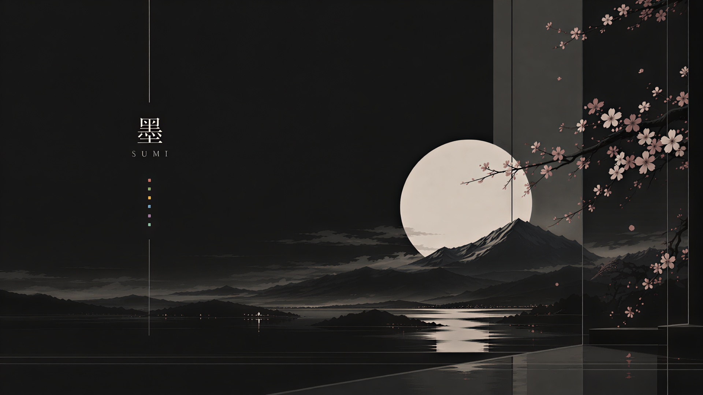

# Sumi

A dark Omarchy theme built around ink-black surfaces and a muted teal accent.



## Install

```bash
omarchy theme install https://github.com/suvikyi/omarchy-sumi-theme
omarchy theme set sumi
```

## What's included

- `colors.toml` — the palette, including ANSI, semantic surfaces, and Hyprland border colors
- `backgrounds/sumi-00.png` — the matching wallpaper

## Palette

| Role | Color |
| --- | --- |
| Background | `#121212` |
| Darker background | `#080808` |
| Lighter background | `#202020` |
| Foreground | `#dadad5` |
| Accent | `#72aba4` |
| Active border | `#87c1bb` |
| Selection | `#2d4541` |

Full ANSI and bright ANSI colors are defined in [`colors.toml`](colors.toml).
